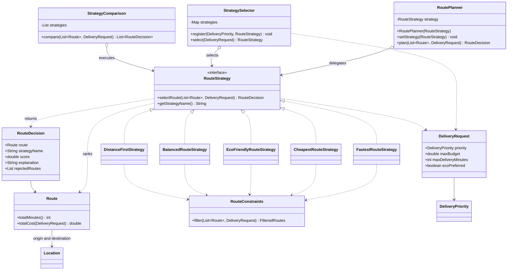
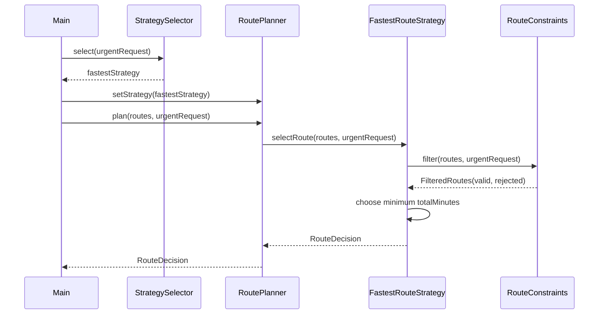

# Smart Delivery and Route Optimization

A Java 17 console application for Assignment 5. It selects a delivery route using the Strategy pattern. Eight candidate routes share the same origin and destination. Each route has distance, estimated time, traffic delay, base cost, fees, emissions and availability.

## Run

Requirements: JDK 17. Gradle 8.14.3 is provided through the Gradle Wrapper, so a separate Gradle installation is not needed. Make sure `JAVA_HOME` points to JDK 17. The first build needs internet access to download Gradle and test dependencies.

On Windows PowerShell:

```powershell
.\gradlew.bat clean build
.\gradlew.bat run
```

On macOS or Linux:

```sh
sh gradlew clean build
sh gradlew run
```

The built application can also be run with `java -jar build/libs/smart-delivery-1.0.0.jar`.

In IntelliJ IDEA, open the project folder or `build.gradle`, select JDK 17 as both the Project SDK and Gradle JVM, import the Gradle project and run `delivery.Main`. Tests can be run from `RoutePlannerTest` or with `.\gradlew.bat test`.

The demo runs without user input. It shows runtime switching, automatic selection, comparison and three handled failures. To experiment, change the requests in `Main` or the routes in `DemoData`.

## Architecture

| Component | Responsibility |
| --- | --- |
| `RoutePlanner` | Context; stores a `RouteStrategy` and delegates `plan` to it |
| `RouteStrategy` | Interface with `selectRoute` and `getStrategyName` |
| Five concrete strategies | Filter candidates and apply their own selection algorithm |
| `StrategySelector` | Maps request priorities to strategies using an extensible `EnumMap` |
| `RouteConstraints` | Rejects unavailable, over-budget and late routes before scoring |
| `StrategyComparison` | Runs a supplied list of strategies against the same request |
| `RouteDecision` | Returns the chosen route, strategy name, score, reason and rejected candidates |
| `Route`, `Location`, `DeliveryRequest` | Validated domain records |

`RoutePlanner` depends only on the interface. It contains no route-selection conditions or checks for concrete strategy types. `Main` creates one planner and changes its algorithm four times with `setStrategy`.

Strategy solves the problem of interchangeable route-selection algorithms. A condition in `StrategySelector` chooses an algorithm; it does not implement it. The selector decides **which** strategy to use, while a strategy decides **how** to select a route.

## Strategies and formulas

All scores are minimized. Ties keep the first candidate in the input list.

- **FastestRouteStrategy:** `finalTime = estimatedMinutes + trafficPenaltyMinutes`.
- **CheapestRouteStrategy:** `totalCost = baseCost + distanceKm * 100 + prioritySurcharge + additionalFees`. The surcharge is 500 for URGENT and 0 otherwise. Costs use KZT in the demo. The shared calculation is in `Route.totalCost` so budget validation and ranking use the same price.
- **EcoFriendlyRouteStrategy:** `ecoScore = carbonEmission * 0.9 + distanceKm * 0.1`. Emissions are measured in kg. These coefficients are demonstration scoring factors, not a physical emissions formula. Environmental ranking belongs to this strategy because it is a distinct optimization policy.
- **BalancedRouteStrategy:** `score = normalizedTime * timeWeight + normalizedCost * costWeight + normalizedDistance * distanceWeight + normalizedEmission * emissionWeight`.
- **DistanceFirstStrategy:** chooses the smallest `distanceKm` among valid routes.

Balanced normalization uses `(value - min) / (max - min)` over valid candidates only. If all values for a criterion are equal, its normalized value is 0. Default weights are 0.4, 0.3, 0.1 and 0.2. Each must be finite and between 0 and 1; their sum must equal 1 within a tolerance of 0.000001.

## Automatic selection and constraints

| Request | Strategy |
| --- | --- |
| URGENT | Fastest |
| ECONOMY | Cheapest |
| ECO | Eco friendly |
| STANDARD | Balanced |

`ecoPreferred` selects Eco friendly for any non-urgent request. URGENT keeps Fastest even when eco delivery is preferred. `StrategySelector.register` can replace a priority mapping without changing its selection method.

Availability, total cost and final time are hard constraints for every strategy. Exact budget and deadline values are allowed. No strategy can select a rejected route. An empty candidate list or a request with no feasible route throws `NoSuitableRouteException`. Invalid domain values and invalid weights are rejected when objects are created; missing required objects are rejected with `NullPointerException` and a message.

## Example console output

For STANDARD, budget 6000, deadline 60 minutes and no eco preference, the comparison prints these result lines. Each result also includes a reason and rejected routes.

```text
Fastest -> R2 Highway | time: 20 min | cost: 5100.00 | distance: 24.0 km | CO2: 5.0 kg | score: 20.0000
Cheapest -> R3 Economy | time: 50 min | cost: 1700.00 | distance: 12.0 km | CO2: 2.8 kg | score: 1700.0000
Eco friendly -> R4 Electric | time: 38 min | cost: 2700.00 | distance: 14.0 km | CO2: 0.5 kg | score: 1.8500
Balanced -> R6 Balanced | time: 29 min | cost: 2700.00 | distance: 15.0 km | CO2: 1.8 kg | score: 0.3049
Distance first -> R5 Short | time: 42 min | cost: 2300.00 | distance: 8.0 km | CO2: 2.0 kg | score: 8.0000
```

R7 is unavailable and R8 exceeds this budget. With an URGENT request, budget 10000 and deadline 25, Fastest selects R8 instead. Scores use different units between strategies and should not be compared numerically across algorithms.

## UML class diagram



## UML sequence diagram

The automatic selection section reuses the planner previously created by `Main`.



## Extension and SOLID

To add an algorithm, implement `RouteStrategy`, use `RouteConstraints.filter` and supply the instance to a planner or comparison. Register it in `StrategySelector` if it should be selected automatically. The fifth strategy is `DistanceFirstStrategy`. It is included in the strategy list in `Main` and uses the same interface and constraint filter; `RoutePlanner` needs no special handling for it.

- **SRP:** planning, algorithm selection, constraint filtering and scoring have separate responsibilities.
- **OCP:** new algorithms implement the interface without rewriting the context.
- **DIP:** `RoutePlanner` depends on `RouteStrategy`, not concrete algorithms.

Strategy replaces a behavior at runtime. Bridge separates an abstraction hierarchy from an implementation hierarchy so both can evolve independently. This project has one planning context with interchangeable algorithms, rather than two independently varying hierarchies.

## Tests

Run `.\gradlew.bat clean build`. Verified with JDK 17 and JUnit 5:

```text
31 tests completed, 0 failed, 0 skipped
BUILD SUCCESSFUL
```

Coverage includes all five strategies, traffic, cost components, configurable weights, normalization ties, runtime switching, automatic selection, eco preference, mapping replacement, all shared constraints, exact limits, urgent surcharge, empty input, infeasible requests, invalid values, missing data, comparison and different outcomes for different requests.

## Limitations

The application selects from predefined routes; it does not calculate paths on a road graph. Callers must supply candidates for the same origin and destination. Traffic and emissions are static estimates. Monetary values use `double` for simplicity. Balanced normalization scans the candidates repeatedly and is intended for a small data set. A custom strategy must explicitly use the shared constraint filter. Comparison stops on the first exception rather than returning partial results.
